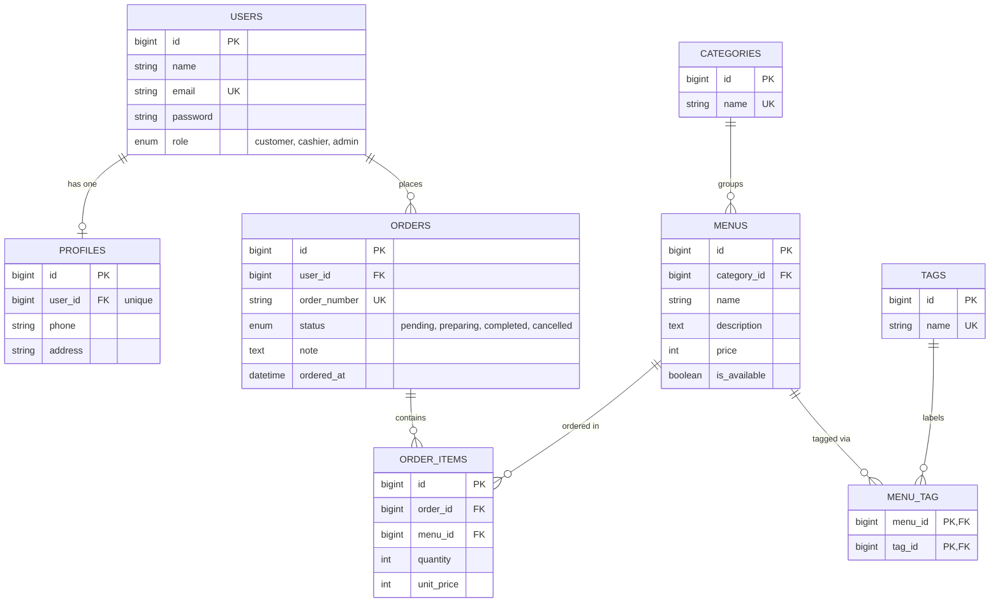

# CafeOrder — Cafe Menu Ordering System

CafeOrder is a cafe menu ordering web application built with **Laravel**, **Blade**, and **Tailwind CSS**. It is the final semester project for the *Object-Oriented Programming 2 (PBO2)* course, with a focus on designing and implementing **database table relationships** using Eloquent ORM.

## Features

- Browse the cafe menu grouped into six categories:
  Coffee, Non-Coffee, Tea, Snacks, Main Course, and Dessert
- Tags for flexible menu labels (for example spicy, vegetarian, best seller)
- Customer accounts with a profile (phone number and address)
- Place an order with several menu items and a quantity for each
- Order status tracking: pending, preparing, completed, or cancelled
- Prices are saved per order item, so old orders keep their original price
- Role-based access: `customer` places orders, `cashier` updates order status, `admin` manages the menu

## Database Design

The full schema and every relationship are documented with Mermaid diagrams in
[`docs/database/erd.md`](docs/database/erd.md).



### Relationships Covered

| Type | Example |
|---|---|
| One-to-One | `User` ↔ `Profile` |
| One-to-Many | `User` → `Order`, `Category` → `Menu`, `Order` → `OrderItem`, `Menu` → `OrderItem` |
| Many-to-Many | `Menu` ↔ `Tag` (`menu_tag`) |
| Many-to-Many with pivot data | `Order` ↔ `Menu` via `order_items` (`quantity`, `unit_price`) |
| Has-Many-Through | `Category` → `OrderItem` through `Menu`, `User` → `OrderItem` through `Order` |

### Business Rules

- Only menus with `is_available = true` can be added to an order.
- `order_items.unit_price` copies the menu price at the time of the order.
- Order total = sum of `quantity × unit_price` of its items. It is computed, not stored.
- A menu appears only once per order; the amount is stored in `quantity`.
- Only customers can place orders. Cashiers and admins see the menu without the order form.
- An order moves `pending` → `preparing` → `completed`. A `pending` or `preparing` order can be `cancelled`. `completed` and `cancelled` are final.
- A customer can cancel only their own `pending` order. Cashiers and admins change the status of any order.
- A category that still has menus, and a menu that is used in an order, cannot be deleted. Mark the menu as unavailable instead.
- Only `admin` users can manage menus, categories, and tags.

## Tech Stack

- PHP 8.3+ and Laravel
- Blade templates
- Tailwind CSS (via Vite)
- MySQL or SQLite

## Getting Started

```bash
# Clone the repository
git clone https://github.com/PabloExelen/laravel5c.git
cd laravel5c

# Install dependencies
composer install
npm install

# Configure the environment
cp .env.example .env
php artisan key:generate

# Create the schema and seed the categories
php artisan migrate --seed

# Start the development servers
npm run dev
php artisan serve
```

Then open <http://localhost:8000>.

### Demo accounts

`php artisan migrate --seed` also creates sample menus, tags, orders, and these accounts:

| Role | Email | Password |
|---|---|---|
| Admin | `admin@example.com` | `password` |
| Cashier | `cashier@example.com` | `password` |
| Customer | `customer@example.com` | `password` |

### Pages

| Page | Who |
|---|---|
| `/` (menu, with tag filter) | everyone |
| `/register`, `/login` | guests |
| `/profile`, `/orders`, `/orders/{id}` | signed-in users (a customer sees only their own orders) |
| Place or cancel an order | customers |
| `/staff/orders` (order queue, status changes) | cashiers and admins |
| `/admin/menus`, `/admin/categories`, `/admin/tags` | admins |

### Running the tests

```bash
php artisan test
```

The feature tests cover authentication, roles, profiles, the menu, order placement, order status changes, order history, and the admin pages.

## Project Structure

```
app/Http/Controllers/  Page controllers (Admin/ and Staff/ for the staff areas)
app/Http/Middleware/   Role check for staff and admin pages
app/Services/      Order placement and status rules
app/Models/        Eloquent models and relationships
database/
  migrations/      Table definitions
  factories/       Fake data generators
  seeders/         Categories and sample data
resources/views/   Blade templates
routes/web.php      All routes
tests/Feature/     Feature tests
docs/
  database/        ERD and relationship documentation
  progress/        Phase tracker (P01, ...)
```

## Roadmap

- [x] Database design and documentation
- [x] Migrations, models, factories, and seeders
- [x] Authentication and role-based access
- [x] Menu, category, and tag management
- [x] Ordering and order status
- [x] Order history

## Author

Muhammad Yusuf — NPM 2410010526 — 5C TI REG BJB

## License

Released under the [MIT License](https://opensource.org/licenses/MIT).
