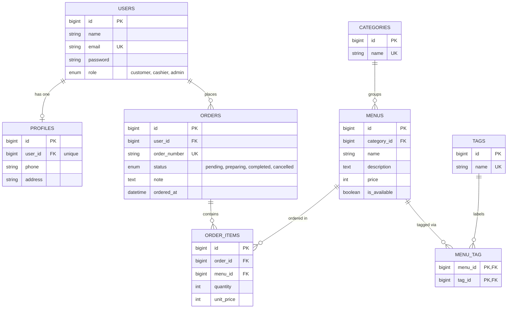

# CafeOrder — Cafe Menu Ordering System

CafeOrder is a cafe menu ordering web application built with **Laravel**, **Blade**, and **Tailwind CSS**. It is the final semester project for the *Object-Oriented Programming 2 (PBO2)* course, with a focus on designing and implementing **database table relationships** using Eloquent ORM.

## Features

- Browse the cafe menu grouped into six categories:
  Kopi, Non-Kopi, Teh, Camilan, Makanan Berat, and Dessert
  (38 demo menus typical of Indonesian cafes, such as Kopi Susu Gula Aren, Nasi Goreng Kampung, and Es Cendol)
- Minimal, modern, responsive interface with live search, category chips, quantity steppers, a live cart total, toasts, and confirm dialogs
- Dashboard for every role, a menu detail page, and an admin user management page
- Menu photos (upload or shipped files), stock, order type (dine in or takeaway), table number, and item preferences
- Simulated payments (QRIS, virtual account, e-wallet, cash with change), printable receipt, and live order updates
- Sales reports with CSV export (admin)
- Password reset and email verification
- Indonesian and English interface (language switch in the navbar)
- 72 menus, 40 customers, and 1000 demo orders from the seeder
- Tags for flexible menu labels (for example spicy, vegetarian, best seller)
- Customer accounts with a profile (phone number and address)
- Place an order with several menu items and a quantity for each
- Order status tracking: pending, preparing, completed, or cancelled
- Prices are saved per order item, so old orders keep their original price
- Role-based access: `customer` places orders, `cashier` updates order status, `admin` manages the menu

## Database Design

The full schema and every relationship are documented with Mermaid diagrams in
[`docs/database/erd.md`](docs/database/erd.md).



### Relationships Covered

| Type | Example |
|---|---|
| One-to-One | `User` ↔ `Profile` |
| One-to-Many | `User` → `Order`, `Category` → `Menu`, `Order` → `OrderItem`, `Menu` → `OrderItem` |
| Many-to-Many | `Menu` ↔ `Tag` (`menu_tag`) |
| Many-to-Many with pivot data | `Order` ↔ `Menu` via `order_items` (`quantity`, `unit_price`) |
| Has-Many-Through | `Category` → `OrderItem` through `Menu`, `User` → `OrderItem` through `Order` |

### Business Rules

- Only menus with `is_available = true` can be added to an order.
- `order_items.unit_price` copies the menu price at the time of the order.
- Order total = sum of `quantity × unit_price` of its items. It is computed, not stored.
- A menu appears only once per order; the amount is stored in `quantity`.
- Only customers can place orders. Cashiers and admins see the menu without the order form.
- An order moves `pending` → `preparing` → `completed`. A `pending` or `preparing` order can be `cancelled`. `completed` and `cancelled` are final.
- A customer can cancel only their own `pending` order. Cashiers and admins change the status of any order.
- A category that still has menus, and a menu that is used in an order, cannot be deleted. Mark the menu as unavailable instead.
- Only `admin` users can manage menus, categories, and tags.

## Tech Stack

- PHP 8.3+ and Laravel
- Blade templates
- Tailwind CSS (via Vite)
- MySQL or SQLite

## Getting Started

```bash
# Clone the repository
git clone https://github.com/PabloExelen/laravel5c.git
cd laravel5c

# Install dependencies
composer install
npm install

# Configure the environment
cp .env.example .env
php artisan key:generate

# Create the schema and seed the categories
php artisan migrate --seed

# Start the development servers
npm run dev
php artisan serve
```

Then open <http://localhost:8000>.

### Demo accounts

`php artisan migrate --seed` also creates sample menus, tags, orders, and these accounts:

| Role | Email | Password |
|---|---|---|
| Admin | `admin@example.com` | `password` |
| Cashier | `cashier@example.com` | `password` |
| Customer | `customer@example.com` | `password` |

### Pages

| Page | Who |
|---|---|
| `/` (menu, live search, category and tag filter) | everyone |
| `/menu/{id}` (menu detail) | everyone |
| `/dashboard` | signed-in users (content depends on the role) |
| `/forgot-password`, `/reset-password/{token}` | guests |
| `/email/verify` | signed-in users |
| `/orders/{id}/pay`, `/orders/{id}/receipt` | the customer who owns the order (receipt: staff too) |
| `/admin/reports` and CSV export | admins |
| `/register`, `/login` | guests |
| `/profile`, `/orders`, `/orders/{id}` | signed-in users (a customer sees only their own orders) |
| Place or cancel an order | customers |
| `/staff/orders` (order queue, status changes) | cashiers and admins |
| `/admin/menus`, `/admin/categories`, `/admin/tags`, `/admin/users` | admins |
| Delete a completed or cancelled order | admins |

### Running the tests

```bash
php artisan test
```

The feature tests cover authentication, roles, profiles, the menu, order placement, order status changes, order history, the admin pages, the dashboard, user management, the menu detail page, and the seeders.

## Project Structure

```
app/Http/Controllers/  Page controllers (Admin/ and Staff/ for the staff areas)
app/Http/Middleware/   Role check for staff and admin pages
app/Services/      Order placement and status rules
app/Models/        Eloquent models and relationships
database/
  migrations/      Table definitions
  factories/       Fake data generators
  seeders/         Categories, Indonesian cafe menu, and sample data
resources/views/   Blade templates
routes/web.php      All routes
tests/Feature/     Feature tests
docs/
  database/        ERD and relationship documentation
  progress/        Phase tracker (P01, ...)
```

## Roadmap

- [x] Database design and documentation
- [x] Migrations, models, factories, and seeders
- [x] Authentication and role-based access
- [x] Menu, category, and tag management
- [x] Ordering and order status
- [x] Order history
- [x] Indonesian cafe menu, minimal modern UI, dashboard, and complete CRUD (P03)
- [x] Photos, stock, simulated payments, receipts, reports, password reset, email verification, and Indonesian interface (P04)

## Author

Muhammad Yusuf — NPM 2410010526 — 5C TI REG BJB

## License

Released under the [MIT License](https://opensource.org/licenses/MIT).

## Setup notes for P04

```bash
php artisan storage:link        # uploaded menu photos
php artisan migrate:fresh --seed
php artisan menu:link-photos    # after adding photos to public/images/menu (see docs/menu-photos.md)
```

- Set `APP_LOCALE=id` in `.env` for the Indonesian interface by default (the tests force English).
- Mail uses the `log` driver: password reset and verification links are written to `storage/logs/laravel.log`.
- The seeder creates 1000 orders and takes a few seconds. Change it with `config(['seeding.orders' => 200])` or edit `DemoDataSeeder`.
