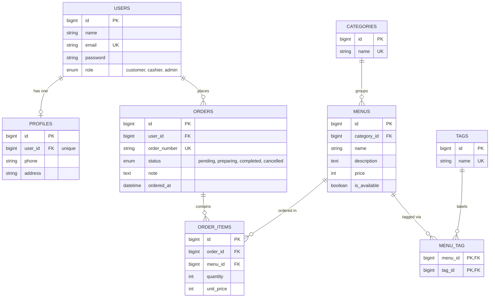

# Database Design — Entity Relationship Diagram

This document describes the database schema of **CafeOrder** and every Eloquent relationship used in the project.

## 1. Entity Relationship Diagram

## 2. Relationship Summary

| Type | Relationship | Eloquent |
|---|---|---|
| One-to-One | `User` ↔ `Profile` | `hasOne` / `belongsTo` |
| One-to-Many | `User` → `Order` | `hasMany` / `belongsTo` |
| One-to-Many | `Category` → `Menu` | `hasMany` / `belongsTo` |
| One-to-Many | `Order` → `OrderItem` | `hasMany` / `belongsTo` |
| One-to-Many | `Menu` → `OrderItem` | `hasMany` / `belongsTo` |
| Many-to-Many | `Menu` ↔ `Tag` (pivot `menu_tag`) | `belongsToMany` |
| Many-to-Many + pivot data | `Order` ↔ `Menu` (table `order_items`, columns `quantity`, `unit_price`) | `belongsToMany` + `withPivot` |
| Has-Many-Through | `Category` → `OrderItem` through `Menu` | `hasManyThrough` |
| Has-Many-Through | `User` → `OrderItem` through `Order` | `hasManyThrough` |

`order_items` is both a table with its own `id` and the link between `Order` and `Menu`. It is modelled as an Eloquent model (`OrderItem`) for the one-to-many and has-many-through relationships, and the `Order` ↔ `Menu` many-to-many relationship points to the same table.

## 3. Categories (seeded)

The `categories` table is populated by a seeder with the six built-in categories:

| Name |
|---|
| Coffee |
| Non-Coffee |
| Tea |
| Snacks |
| Main Course |
| Dessert |

## 4. Design Notes

- **Unique constraints:** `users.email`, `profiles.user_id`, `categories.name`, `tags.name`, `orders.order_number`, and (`order_items.order_id`, `order_items.menu_id`) so a menu appears once per order and the amount is stored in `quantity`.
- **Composite primary key:** the pivot table `menu_tag` uses its two foreign keys as the primary key, so a menu cannot get the same tag twice.
- **Price history:** `order_items.unit_price` copies `menus.price` at the time of the order, so changing a menu price later does not change old orders.
- **Order total** is computed, not stored: sum of `quantity × unit_price` over the items of an order, available as `Order::total()`.
- **Availability:** only menus with `is_available = true` can be added to an order. This is enforced in application logic.
- **Roles:** `customer` places orders, `cashier` updates the order status, `admin` manages menus, categories, and tags.
- **Cascade rules:** deleting a user cascades to their profile and is restricted while the user still has orders, so order history is kept; deleting an order cascades to its items; deleting a category is restricted while menus still use it; deleting a menu is restricted while order items still use it; deleting a menu or a tag cascades to its `menu_tag` rows.
